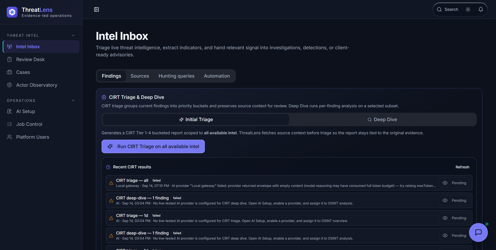
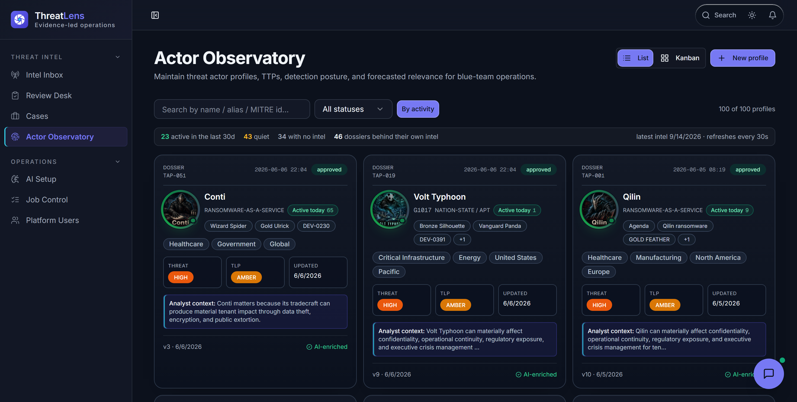
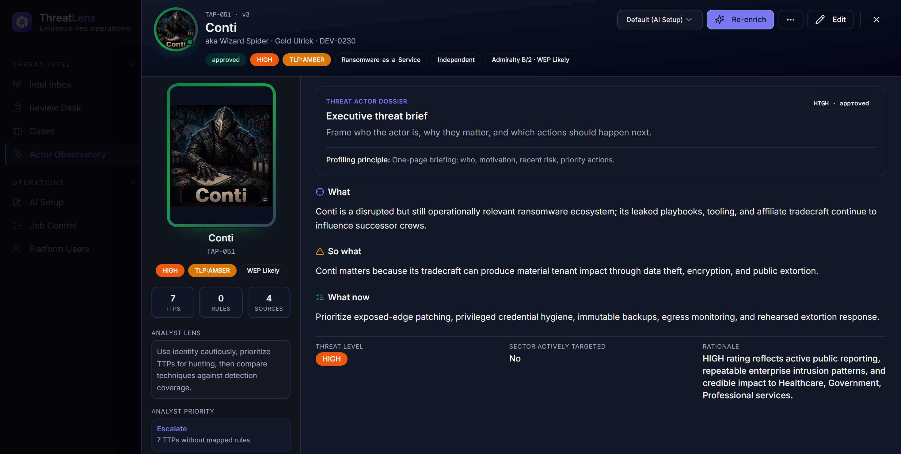
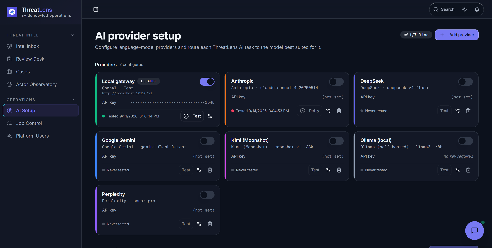

<p align="center">
  
</p>

<p align="center">Open-source cyber threat intelligence workstation for OSINT triage, Threat Actor Profiles, AI-assisted analysis, and hunt-query generation.</p>

<p align="center">
  <a href="LICENSE"></a>
  
  
  <a href="https://github.com/TejaCyberX/ThreatLens/actions/workflows/release.yml"></a>
  <a href="https://github.com/TejaCyberX/ThreatLens/actions/workflows/codeql.yml"></a>
  <a href="https://snyk.io/test/github/TejaCyberX/ThreatLens"></a>
</p>

ThreatLens Batch One is an open-source cyber threat intelligence (CTI) workstation for security analysts, threat-intelligence teams, detection engineers, and managed security service providers. It connects open-source intelligence (OSINT) monitoring, evidence review, Threat Actor Profiles, AI-assisted triage, and defensive hunt-query drafting in one local analyst workspace.

The core workflow is simple: collect public threat signals, review the evidence, enrich actor context, draft hunt logic for SIEM and detection platforms, and keep source traceability visible from intake to action.

Before running a downloaded release archive, verify its checksum and signature with [VERIFYING.md](./VERIFYING.md).

This release is deliberately focused: a clean, inspectable workstation for open-source intelligence review and threat-actor analysis. It is built to be useful on day one, while leaving the product room to grow through future public releases.

Static demo site: [tejacyberx.github.io/ThreatLens](https://tejacyberx.github.io/ThreatLens/).

## Product Screenshots

| Intel Inbox | Threat Actor Profiles |
| --- | --- |
|  |  |

| Threat Actor Profile Detail | AI Setup |
| --- | --- |
|  |  |

## Repository Summary

| Field | Details |
| --- | --- |
| Product category | Open-source CTI workstation, OSINT triage tool, threat actor profile manager, AI-assisted threat-intelligence workspace |
| Primary users | SOC analysts, CTI analysts, detection engineers, incident-response teams, MSSP analysts, security researchers |
| Core workflow | OSINT finding -> evidence review -> actor context -> hunt-query draft -> analyst action |
| AI posture | Bring your own provider key; strict mode surfaces real provider errors instead of mock output |
| Data posture | Public seed data ships in git; runtime databases, API keys, uploaded portraits, and secrets stay local |
| Deployment model | Local Express + React app backed by SQLite |

ThreatLens is relevant if you are searching for:

- an open-source threat intelligence platform for OSINT triage;
- a cyber threat intelligence tool for threat actor profiles and actor dossiers;
- an AI-assisted SOC analyst workstation that keeps evidence traceability visible;
- a hunt-query generator for Splunk SPL, Elastic KQL, Microsoft Sentinel KQL, Google Chronicle YARA-L, Palo Alto Cortex XQL, Sigma, and YARA;
- a local-first security operations tool for evaluating public threat reports, indicators, tactics, techniques, procedures, and analyst notes.

## Use Cases

- Triage public OSINT findings with source context, severity, ATT&CK scope, affected technology, and analyst notes in one workflow.
- Maintain Threat Actor Profiles with aliases, campaigns, indicators, tactics, techniques, procedures, confidence drivers, evidence references, and dossier exports.
- Use configured AI providers to assist with finding analysis, CIRT-style triage, deep-dive review, actor enrichment, and hunt-query drafting.
- Draft defensive hunt logic for Splunk SPL, Elastic KQL, Microsoft Sentinel KQL, Google Chronicle YARA-L, Palo Alto Cortex XQL, Sigma, and YARA.
- Evaluate a local-first CTI workstation with sanitized public seed data, watermarked actor portraits, no bundled secrets, and strict provider error handling.

## Key Capabilities

Batch One focuses on the analyst workflow from signal intake to defense-ready output:

- **Intelligence Feed** for parsed OSINT findings, source review, AI triage, CIRT-style deep dive, and finding-level analysis. The feed refreshes itself while open.
- **My Organization** to tell ThreatLens what you run (vendors, products, cloud). Every finding is matched against it, and a **Global / My organization** switch in the feed and queue shows only what affects you, ranked by exposure (KEV, EPSS, asset criticality).
- **Detection Library** with named threat indicators from open feeds, 2,600+ Sigma rules and YARA rules, a MITRE ATT&CK matrix coloured by detection coverage, a rule-based Sigma-to-EDR converter, and a per-finding check that says whether a detection already exists.
- **IoC export** in the import format of CrowdStrike, Defender for Endpoint, SentinelOne, Cortex XDR, Elastic and Splunk, plus AI generation of IoAs and EDR-native rules.
- **Analyst Queue** for the working queue ranked by real exploitation evidence (CISA KEV, FIRST EPSS, CVSS), triage SLAs and ownership, ATT&CK hunt coverage, private-document ingest, and report generation.
- **Cases** to group findings, actors, hunt queries and CVEs into one investigation with notes, an evidence timeline, and a one-click case report.
- **Threat Actors** for Threat Actor Profiles, actor aliases, TTPs, IOCs, campaigns, evidence, portraits, and exports.
- **Hunting queries** generated from selected intelligence, with **hunt result capture** so you record what each hunt actually found in your environment.
- **ATT&CK Navigator layers** per actor and for overall hunt coverage.
- **CVE enrichment** from NVD (CVSS), FIRST EPSS (exploit probability) and CISA KEV (known exploited), refreshed in the background.
- **AI Settings** for your own DeepSeek, OpenAI, Anthropic, or Google Gemini provider keys, with per-provider tuning (temperature, token and timeout budgets, reasoning effort, org/project IDs, custom base URL and headers).
- **Job Monitor** for background AI and ingestion work, with real cancellation.
- **User Management** for local admin and reviewer accounts.

## Release Scope

Batch One is intentionally focused on the analyst workstation experience: Intel Inbox, Actor Observatory, Threat Actor Profiles, Hunting Queries, AI Setup, Job Control, and local platform access controls. It is designed to be useful as a public open-source release while keeping the operating surface clear, inspectable, and easy to run locally.

Some broader platform capabilities are outside this public release. Rather than exposing every internal module or future direction, this repository keeps the Batch One boundary simple: threat-intelligence intake, actor analysis, and evidence-led hunting workflows.

Follow the repository for future public releases as the project expands its evidence-led security operations workflows.

## Quick Start

### 1. Clone and install

```bash
git clone https://github.com/TejaCyberX/ThreatLens.git
cd Threatlens
npm install
```

### 2. Restore the public BatchOne dataset

```bash
npm run db:restore-public
```

This creates a local git-ignored `data/data.db` (or the path in `THREATLENS_DB_PATH`) from the sanitized public release assets:

```text
data/public/threatlens-threat-intel-public.db
data/public/threatlens-threat-actors-public.db
data/public/portraits/
```

The restore step copies public threat-intel findings, Threat Actor Profiles, and watermarked Threat Actor Profile portraits into local runtime paths. It does **not** restore API keys or private secrets.

If you intentionally want to rebuild an existing local runtime database:

```bash
npm run db:restore-public -- --force
```

### 3. Start the platform

```bash
npm run dev
```

Open:

```text
http://localhost:7099
```

ThreatLens binds to `127.0.0.1` by default — it holds credentials, provider
keys and unreviewed intel, so it is not reachable from the rest of your
network until you ask for it. To serve other machines, set
`THREATLENS_HOST=0.0.0.0` and put a TLS-terminating reverse proxy in front.

### 4. Sign in with your generated first-run account

ThreatLens ships **no passwords**. On first boot it creates two accounts and
generates a random password for each, unique to your install:

| Role | Email |
| --- | --- |
| Platform admin | `admin@threatlens.local` |
| Read-only reviewer | `reviewer@threatlens.local` |

The generated passwords are printed to the server log and written to
`data/initial-credentials.json` (git-ignored, mode 600). The sign-in page also
shows them, but only while the accounts still use them and only to a browser on
the same machine — set `THREATLENS_SHOW_SEED_CREDENTIALS=1` if you reach the UI
from another host.

Both accounts must change the password before platform functions unlock. Doing
so deletes `data/initial-credentials.json` and removes the sign-in hint, so a
configured install carries no first-run credential anywhere. MFA is optional and
recommended; set `THREATLENS_REQUIRE_MFA=1` to make enrolment mandatory.

### 5. Add your AI provider key

Open `/#/ai-setup` and add your own AI provider key. ThreatLens supports live routing for DeepSeek, OpenAI, Anthropic, and Google Gemini.

AI provider keys are stored separately from public seed data. They are not bundled with the repository and are not restored from the public seed data. When strict mode is enabled, unavailable or misconfigured providers return real setup errors instead of silent mock output.

## What Ships In Git

The public repository is designed to be cloned without private runtime state.

Tracked public seed assets:

```text
data/public/threatlens-threat-intel-public.db
data/public/threatlens-threat-actors-public.db
data/public/portraits/
```

Local-only runtime and secret paths stay git-ignored:

```text
data.db
data/data.db
data/secrets/
data/private/
data/portraits/
.env
dist/
node_modules/
```

In practical terms: a fresh GitHub clone will not look exactly like the maintainer machine until the user runs `npm run db:restore-public` and adds their own AI keys.

## Core Workflows

A summary follows; [docs/USER-GUIDE.md](./docs/USER-GUIDE.md) covers each of
these end to end, including the evidence model and the exploitation-ranking
formula.

### Intelligence Feed

Review parsed OSINT findings, filter advertisements and low-actionability items, inspect source and ingestion timestamps, run AI analysis on individual findings, and queue CIRT triage or deep-dive jobs.

### Threat Actors

Inspect and maintain Threat Actor Profiles with aliases, sector and region targeting, TTPs, IOCs, campaigns, confidence drivers, evidence references, portraits, and exportable dossiers.

### Hunting Queries

Generate defensive hunt queries from selected intelligence. The goal is practical validation content that remains linked to source findings and actor context.

### Analyst Queue

Work the queue in exploitation order rather than publication order. Every CVE seen in a finding is enriched from NVD, FIRST EPSS and CISA KEV, and the queue ranks by that evidence plus severity, escalation and overdue state. Claim items, set due dates, and watch triage SLAs (backlog age, mean/median time to triage, dismissal rate per source — a source that is dismissed 80% of the time is costing analyst time).

The same page carries ATT&CK hunt coverage (which techniques you have observed, hunted, hit, or never hunted), private-document ingest, and the report builder.

### My Organization

Add the technology you run, with a criticality for each (presets cover common network, cloud, OS and web stacks, and aliases catch the names advisories actually use). Matching is word-boundary based and explainable: each badge says which asset matched and why the finding is **Urgent** (known exploited, high EPSS, or critical CVSS on a critical asset), **High** or **Watch**. Short names such as "AWS" only match the affected-technology list and titles, never free text, to avoid noise.

### Detection Library

- **Named IoCs** from open feeds (abuse.ch Feodo Tracker, C2IntelFeeds, OpenPhish, the CIRCL OSINT feed), refreshed hourly. Click a threat name to see its indicators or export them for your EDR.
- **Detection rules**: the SigmaHQ community rules and ReversingLabs YARA rules, searchable by text, CVE, ATT&CK technique, product and severity, refreshed weekly. Rules keep their original author and licence.
- **MITRE ATT&CK**: the Enterprise matrix with rule counts per technique and MITRE's own detection strategies, so you can see where you have no coverage.
- **Convert**: Sigma process-creation rules convert to Defender KQL, CrowdStrike CQL, SentinelOne Deep Visibility, Cortex XQL, Elastic EQL and Splunk SPL without AI. Anything that cannot be expressed is refused with the reason, never guessed. Always test converted queries.
- **Coverage check** on every finding: covered, partially covered, or a gap, with a one-click **Generate detection** for gaps. AI-generated rules are checked for wrong ATT&CK mappings and known syntax slips and carry `REVIEW:` notes; they still need a human review before deployment.

Feeds and rule sets are downloaded at runtime from their publishers, not redistributed in this repository. See [NOTICE](./NOTICE) for licences and terms.

### Cases

Open a case when something needs more than triage. Link findings, threat actors, hunt queries and CVEs; the case aggregates their indicators, CVEs, ATT&CK techniques and hunt outcomes, builds a timeline, and exports a case report in DOCX or Markdown.

### Private intel ingest

Upload the intel that never appears in RSS — ISAC bulletins, vendor PDFs, incident write-ups (PDF, Markdown, text, HTML, JSON; 10 MB max). The text is extracted server-side and pushed through the same CVE / indicator / technology / actor extraction as feed items, producing a normal finding that triages, hunts, and reports like any other.

### Reports

Three deterministic briefs — executive brief, threat landscape, and case report — in DOCX or Markdown. Every section is provenance-tagged: **[verified]** analyst-recorded, **[feed]** ingested source data, **[ai]** model output that has not been independently verified.

### Analyst Chat

Use the floating analyst chat for general security questions, threat-intel reasoning, Threat Actor Profile context, hunt-query guidance, or source URL review. When a URL is supplied, the server fetches source context before asking the configured AI provider to analyze it.

## Security Model

- **Authorized use only:** use ThreatLens only for defensive security work on systems, data, and sources you are allowed to assess.
- **Strict mode:** production blocks silent mock fallbacks and surfaces provider/configuration errors.
- **No bundled secrets:** AI keys and secret databases are not committed.
- **No durable browser storage:** the app avoids localStorage, sessionStorage, IndexedDB, cookies, and URL tokens for session/application state.
- **Server-side session expiry:** bearer sessions are validated against the server database.

Default session lifetimes:

| Account type | Idle timeout | Absolute timeout |
| --- | ---: | ---: |
| Platform admin | 7 days | 30 days |
| Read-only reviewer / non-admin | 30 days | 90 days |

Override with:

```text
THREATLENS_ADMIN_SESSION_IDLE_MS
THREATLENS_ADMIN_SESSION_ABSOLUTE_MS
THREATLENS_SESSION_IDLE_MS
THREATLENS_SESSION_ABSOLUTE_MS
```

Report security issues through the process in [SECURITY.md](./SECURITY.md). Please do not file public issues for vulnerabilities.

## Scripts

```bash
npm run dev                # start local Express + Vite development server
npm run build              # build production client/server bundle
npm start                  # run the built server
npm run db:restore-public  # create local data/data.db from public BatchOne seed assets
npm run setup:batchone     # compatibility alias for the same restore workflow
npm run db:export-public   # export sanitized public seed DBs from a populated workspace
npm run lint               # ESLint
npm test                   # Vitest
npm run typecheck          # full TypeScript check
npm run check              # formatting baseline + zero-warning lint + tests + typecheck baseline
npm run security:snyk      # authenticated Snyk dependency scan
```

## Requirements

- Node.js 20.x or 22.x (the repository pins Node 22 through `.nvmrc`; Node 25 is not supported for local native-module builds).
- npm 9+.
- SQLite-compatible local filesystem.

## Production Build

```bash
npm run build
NODE_ENV=production npm start
```

or:

```bash
NODE_ENV=production node dist/index.cjs
```

When `NODE_ENV=production`, strict mode is enabled by default. Missing AI providers or blocked mock fallbacks return explicit errors rather than synthetic results.

## Environment Variables

| Variable | Default | Purpose |
| --- | --- | --- |
| `NODE_ENV` | `development` | Switches development/production behavior. |
| `PORT` | `7099` | HTTP listen port. |
| `THREATLENS_DB_PATH` | `data/data.db` (a pre-existing root `data.db` is still honoured) | Runtime SQLite workspace database. Keep it inside the directory you back up / mount. |
| `THREATLENS_SECRET_DB` | `data/secrets/threatlens-secrets.db` | Separate SQLite file holding provider-key ciphertext. |
| `THREATLENS_KEK` | random key in `data/.threatlens-kek` | Key-encryption key for secrets at rest (base64 or passphrase). Set it explicitly when `data/` is not persistent. |
| `THREATLENS_STRICT` | `1` in production | Blocks mock fallback paths and surfaces real missing-provider/upstream errors. |
| `THREATLENS_AI_LIVE` | `1` | Emergency live-AI kill switch for offline development. |
| `THREATLENS_REQUIRE_MFA` | unset (off) | When `1`, every account must enroll TOTP MFA before the workspace unlocks. Accounts that enrolled voluntarily are always prompted for a code at login regardless of this setting. |
| `THREATLENS_ADMIN_SESSION_IDLE_MS` | `604800000` | Admin idle session timeout. |
| `THREATLENS_ADMIN_SESSION_ABSOLUTE_MS` | `2592000000` | Admin absolute session lifetime. |
| `THREATLENS_SESSION_IDLE_MS` | `2592000000` | Reviewer/non-admin idle session timeout. |
| `THREATLENS_SESSION_ABSOLUTE_MS` | `7776000000` | Reviewer/non-admin absolute session lifetime. |

## Repository Map

```text
client/                 React, Vite, Tailwind, shadcn/Radix UI
server/                 Express API, SQLite storage, AI dispatch, OSINT ingestion
shared/                 Shared schema, DTOs, validation, access policy
data/public/            Sanitized public BatchOne seed DBs and portraits
scripts/                Public DB restore/export and release safety helpers
spec/                   API and connector metadata snapshots
tests/                  Security and regression tests
```

## Contributing

Read [CONTRIBUTING.md](./CONTRIBUTING.md) before opening a pull request.

Useful guardrails:

- Keep BatchOne scoped to Intel Inbox, Actor Observatory, AI Setup, Job Control, Platform Users, and supporting APIs.
- Do not expand the release surface without an explicit BatchOne scope decision.
- Use `apiRequest` on the client rather than raw `fetch`.
- Keep long AI work asynchronous and visible in Job Control.
- Do not commit runtime databases, secret stores, generated screenshots, logs, or uploaded private portraits.

## Further Reading

- [docs/USER-GUIDE.md](./docs/USER-GUIDE.md) - how to run the workflow: triage, cases, hunts, CVE ranking, ATT&CK coverage, reports.
- [ARCHITECTURE.md](./ARCHITECTURE.md) - system architecture and refactor notes.
- [SECURITY.md](./SECURITY.md) - security model, secret handling, and responsible disclosure.
- [DEPLOYMENT.md](./DEPLOYMENT.md) - deployment guidance.
- [data/README.md](./data/README.md) - public seed data and restore notes.
- [CONTRIBUTORS.md](./CONTRIBUTORS.md) - maintainer and AI-assisted contribution credits.

## Contributors

ThreatLens includes AI-assisted implementation, review, and documentation support from **OpenAI Codex** and **Anthropic Claude**.

See [CONTRIBUTORS.md](./CONTRIBUTORS.md) for the full contributor note.

## License

Apache License 2.0. See [LICENSE](./LICENSE) and [NOTICE](./NOTICE).

<sub>Maintained by <a href="https://github.com/TejaCyberX">TejaCyberX</a>. Issues and pull requests welcome.</sub>
